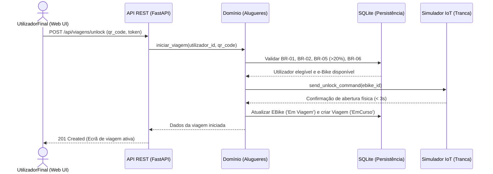

# E5: Desenho

| Campo | Informação |
| :--- | :--- |
| **Projeto:** | Uni-Bike |
| **Grupo:** | César Carvalho [126418], Guilherme Antunes [125039], Leonardo Silva [124823] |
| **Data/versão:** | 2026/11/18, v0.1 (Draft Lab 10 — alvo v1.0 em 2026/11/25) |
| **Sumário:** | Este documento especifica a arquitetura técnica e o desenho do sistema **Uni-Bike**, uma plataforma B2B ciber-física de gestão de frotas de bicicletas elétricas. Concretiza os requisitos com impacto arquitetural, a organização modular em camadas, as decisões de arquitetura (ADR-001 — Python/FastAPI, SQLite e Web HTML/JS testável com Playwright), a integração com sistemas externos (SSO e módulos IoT) e o contrato da API REST para suporte aos *slices* do 1.º incremento. |

## Controlo de Versões

| Data | Autor(es) | Descrição da alteração |
| :--- | :--- | :--- |
| 2026/11/18 | César Carvalho, Guilherme Antunes, Leonardo Silva | Versão inicial (v0.1): objetivos, RNF, vista lógica, ADR-001, alinhamento OpenSpec e API REST. |

---

## 1. Introdução

### 1.1 Sumário executivo

Este relatório apresenta as principais decisões relativamente ao plano técnico para a construção do sistema **Uni-Bike**.

O sistema terá uma aplicação web responsiva em HTML5 / CSS3 / JavaScript que disponibiliza três vistas operacionais distintas:
1. **Interface do Viajante:** autenticação institucional, leitura/introdução de código de desbloqueio e acompanhamento de viagem ativa;
2. **Consola de Operações:** monitorização em tempo real de telemetria GPS e carga de baterias da frota;
3. **Portal B2B de Sustentabilidade:** *dashboard* e exportação de indicadores ESG.

Os módulos de *frontend* integrarão com a lógica aplicacional (implementada em **Python / FastAPI** sobre base de dados **SQLite**) através de uma interface de serviços (**API REST**), apresentada na secção 3, assegurando o desacoplamento entre a apresentação, as regras de domínio e os adaptadores externos (SSO institucional e camada IoT).

### 1.2 Como é que utilizamos os recursos de AI

* **Ferramentas e versão:** OpenSpec CLI `1.13.0` integrado com assistente de IA no fluxo *spec-driven* (`/opsx:propose`, `/opsx:update`, `/opsx:apply`, `/opsx:archive`).
* **Artefactos apoiados por IA vs. equipa:**
  * A escolha tecnológica (`ADR-001`), a definição dos módulos e o contrato de endpoints foram decididos pelo grupo tendo em conta o domínio da equipa em Python.
  * O esqueleto inicial (`app/`, `tests/test_skeleton.py`), o contrato `docs/api/openapi.yaml` e a base deste documento `docs/design/E5-Desenho.md` foram estruturados com apoio do agente e revistos contra a `E4b-SRS v2.0`.
  * *(A completar no fecho da Iteração 4 com o resumo da implementação, revisão `git diff` e verificação dos casos de teste `CT-nn.k` para os 5 slices).*

---

## 2. Arquitetura do sistema

### 2.1 Objetivos gerais

A arquitetura do **Uni-Bike** é orientada para suportar uma operação ciber-física em tempo quase real entre utilizadores finais no campus, gestores operacionais e bicicletas elétricas equipadas com módulos IoT:

1. **Acesso multiplataforma sem instalação:** Os utilizadores e gestores acedem à plataforma através de qualquer browser (*desktop* ou *mobile*) com interface responsiva, eliminando a dependência de instalação nativa nesta fase.
2. **Desacoplamento por Interface de Serviços (API REST):** A separação clara entre o cliente Web e o *backend* permite que futuras aplicações móveis nativas (iOS/Android) ou portais externos consumam os mesmos serviços de domínio sem duplicar regras de negócio.
3. **Isolamento de integrações externas por Adaptadores:** As ligações a fornecedores de identidade (SSO Institucional via OAuth2/OIDC) e ao hardware das bicicletas (tranca IoT e telemetria GPS via MQTT) ficam isoladas atrás de adaptadores. No 1.º incremento, estes adaptadores recorrem a simuladores determinísticos, permitindo substituir pelos serviços reais sem alterar a lógica de domínio.
4. **Baixa latência em operações críticas:** O fluxo de desbloqueio e trancamento de e-bikes exige transações atómicas e rápidas para cumprir o limite de 3 segundos junto à doca física.
5. **Requisito transversal — Testabilidade com Playwright:** A aplicação web deve expor seletores estáveis (`data-testid`) nos elementos interativos e disponibilizar um mecanismo controlado de reposição do estado da base de dados de teste (`/api/test/reset`), garantindo testes automáticos fiáveis e repetíveis.

### 2.2 Requisitos com impacto na arquitetura

A tabela seguinte consolida os Requisitos Não Funcionais (RNF) da `E4b-SRS v2.0` (secção 4.2) e os requisitos transversais de qualidade que determinam diretamente a estrutura da arquitetura:

*Tabela 1: Resumo dos requisitos não funcionais com impacto na arquitetura.*

| ID | Categoria | Descrição e Métrica (`E4b-SRS v2.0`) | Impacto na Arquitetura |
| :--- | :--- | :--- | :--- |
| **RNF-01** | Desempenho | Tempo de resposta $\le 3\text{s}$ entre a leitura do QR Code/validação e a abertura física do fecho em 95% das tentativas (`UC-01`, `UC-04`). | Transações atómicas na base de dados local (SQLite) e processamento assíncrono em FastAPI com timeout curto no adaptador IoT. |
| **RNF-02** | Desempenho / Frequência | Intervalo máximo de atualização dos dados de telemetria (GPS e bateria) na consola operacional até $30\text{s}$ (`UC-06`). | Endpoint dedicado de ingestão (`POST /api/telemetria`) e consulta em tempo real (`GET /api/telemetria/live`), separando a escrita de eventos da consola visual. |
| **RNF-03** | Usabilidade | Facilidade de uso na aplicação para novos utilizadores (*Task Completion Rate* $> 90\%$). | Interface web limpa e responsiva, separada por perfis/vistas claras (Viajante, Operações, ESG). |
| **RNF-04** | Desempenho / Eficiência | Compilação e exportação do relatório de métricas ESG em PDF/CSV em tempo $< 5\text{s}$ para intervalos até 1 ano (`UC-08`). | Tabela de agregação analítica (`metricas_esg`) atualizada incrementalmente no encerramento de cada viagem para evitar varrimentos pesados no histórico. |
| **RNF-05** | Disponibilidade | *Uptime* de $99,5\%$ durante o horário operacional da rede (`06:00 - 00:00`, `BR-01`). | Arquitetura *stateless* na API REST (sessões por JWT) e monitorização de saúde (`/api/health`). |
| **RNF-06** | Segurança | $100\%$ dos canais cifrados (`HTTPS/TLS 1.3` para API e `MQTT` com `TLS` para IoT) e ausência de armazenamento de palavras-passe locais. | Autenticação delegada a fornecedores SSO institucionais via adaptador OIDC/JWT e segregação de acesso por organização cliente. |
| **RT-01** | Testabilidade | A aplicação web deve permitir testes automáticos E2E com Playwright (requisito transversal da Iteração 4). | Utilização consistente de atributos `data-testid` nos componentes HTML e endpoint de ambiente de teste (`POST /api/test/reset`) para reposição da BD. |

### 2.3 Vista geral da arquitetura

O sistema adota uma **arquitetura em camadas** (*Layered Architecture*), organizada em quatro pacotes/camadas principais com dependências unidirecionais de cima para baixo:

```text
+-----------------------------------------------------------------------+
|  CAMADA DE APRESENTAÇÃO (UI - app/static/)                            |
|  [Portal Web Viajante]   [Consola Operações]   [Portal B2B ESG]       |
|  (HTML5 / CSS3 / JS com data-testid — 1.º Incremento)                 |
+-----------------------------------+-----------------------------------+
                                    | HTTP / JSON (API REST)
                                    v
+-----------------------------------------------------------------------+
|  CAMADA DE INTERFACE DE SERVIÇOS (API - app/api/)                     |
|  [Auth API]  [Viagens & Docas API]  [Telemetria & Frota]  [ESG API]   |
|  (FastAPI + Pydantic — 1.º Incremento)                                |
+-----------------------------------+-----------------------------------+
                                    | Chamadas de serviço
                                    v
+-----------------------------------------------------------------------+
|  CAMADA DE LÓGICA DE DOMÍNIO (Domínio - app/domain/)                  |
|  [Autenticação/SSO]  [Alugueres & Geofence]  [Frota & Telemetria]     |
|  [Cálculo & Métricas ESG]   [Alertas & Manutenção (2.º+ Incremento)]  |
+-----------------------------------+-----------------------------------+
                                    | Interfaces / Repositórios
                                    v
+-----------------------------------------------------------------------+
|  CAMADA DE INFRAESTRUTURA (app/infrastructure/)                       |
|  [Repositório SQLite]       [Adaptador/Simulador IoT (MQTT/Tranca)]   |
|  [Adaptador/Simulador SSO]  [Serviço Cartografia / Exportação (2.º+)] |
+-----------------------------------------------------------------------+
```

#### Módulos incluídos no 1.º Incremento (Épico 1) vs. Incrementos Futuros:
* **No 1.º Incremento (Épico 1):**
  * **UI Web (`app/static/`):** Vistas de login SSO, início/fim de viagem por QR Code, listagem/telemetria da frota e consulta ESG.
  * **API REST (`app/api/`):** Controladores FastAPI de `auth`, `docas`, `ebikes`, `viagens`, `telemetria`, `esg` e `test-utils`.
  * **Lógica de Domínio (`app/domain/`):** Serviços de validação de elegibilidade (`BR-02`), horário (`BR-01`), sessão única (`BR-06`), bateria mínima (`BR-05`), *geofence* de docas (`BR-04`) e cálculo de $CO_2$ poupado (`BR-03`).
  * **Infraestrutura (`app/infrastructure/`):** Repositório SQLite (`database.py`) e simuladores locais de Tranca IoT e SSO (`simulators.py`).
* **Reservados para Incrementos Futuros (Épicos 2 a 4):**
  * Gestão de reservas antecipadas (`UC-03`), penalizações por estacionamento ilegal (`UC-04.S2`), bloqueio remoto de motor (`UC-06.S2`), gestão de ordens de manutenção presencial (`UC-05`) e integração real com *brokers* MQTT e mapas externos (`UC-02`).

#### Articulação entre os módulos:
Os clientes web na camada de Apresentação nunca acedem diretamente à base de dados nem aos dispositivos físicos. Todo o pedido entra pela **API REST** (FastAPI), que valida o formato de entrada (Pydantic) e invoca o respetivo serviço na camada de **Lógica de Domínio**. O domínio aplica as regras de negócio (`BR-01` a `BR-06`) e coordena a persistência através do **Repositório SQLite** e o acionamento externo através dos **Adaptadores/Simuladores** de SSO e IoT.

### 2.4 Integração de sistemas e dispositivos

No ecossistema **Uni-Bike**, a integração com o exterior ocorre através de dois eixos principais encapsulados em `app/infrastructure/simulators.py`:
1. **Fornecedor de Identidade (SSO Institucional):** Protocolo OAuth2 / OIDC para validar a pertença do utilizador a uma `OrganizacaoCliente` com contrato ativo, sem guardar palavras-passe localmente.
2. **Camada IoT da e-Bike (Fecho Inteligente e Telemetria):** Comunicação bidirecional (conceitualmente via MQTT sobre TLS 1.3) para enviar comandos de desbloqueio/bloqueio à tranca e ingerir pacotes periódicos de GPS e nível de bateria.

No 1.º incremento, ambos são materializados através de simuladores em memória/adaptadores locais para garantir determinismo nos testes automáticos.



### 2.5 Decisões de arquitetura (ADR)

Os registos completos de decisão encontram-se na pasta `docs/adr/`.

*Tabela 2: Decisões de arquitetura.*

| ADR | Decisão | Alternativas consideradas | Consequências |
| :--- | :--- | :--- | :--- |
| **[ADR-001](../adr/ADR-001-stack.md)** | **Backend:** Python 3.14 + FastAPI (Pydantic); **Frontend:** HTML5 / CSS3 / JavaScript com seletores `data-testid`; **Base de Dados:** SQLite; **Testes:** `pytest` (`TestClient`) + `playwright` (Python). | **Node.js/TypeScript (Express/React/Vitest):** descartado porque a equipa não domina TypeScript. **Java (Spring Boot):** descartado pela maior verbosidade e peso de configuração para o 1.º incremento. | Arranque rápido pela familiaridade com Python; geração nativa de especificação OpenAPI pelo FastAPI; base de dados em ficheiro único fácil de repor nos testes; testes unitários, de API e Playwright na mesma linguagem. |
| **ADR-002** | *(Reservado para a Iteração 5 — Estratégia de teste: níveis, ferramentas e pipeline CI).* | — | — |

### 2.6 Alinhamento com processo (OpenSpec)

O desenho técnico alimenta os agentes de implementação através do ficheiro `openspec/config.yaml` e dos ficheiros `design.md` individuais de cada *change*. Enquanto as *specs* (`spec.md`) definem exclusivamente o comportamento observável e os critérios de aceitação originados na `E4b-SRS`, este documento (**E5**) define a arquitetura transversal (camadas, stack, decisões ADR e contrato da API) e cada `design.md` concretiza apenas os módulos e endpoints afetados pelo respetivo *slice*.

Excerto relevante configurado em `openspec/config.yaml`:

```yaml
context: |
  Arquitetura (E5-Desenho) e Decisões:
  - Arquitetura: docs/design/E5-Desenho.md. Módulos: UI Web (app/static), API REST (app/api), Lógica de Domínio (app/domain), Infraestrutura/Persistência e Simuladores (app/infrastructure).
  - Decisões: docs/adr/ (ADR-001 stack: Python 3.14, FastAPI, SQLite, HTML/CSS/JS testável com Playwright, executor de testes pytest).
  - Contrato da API: docs/api/openapi.yaml. Não criar endpoints fora do contrato.
  - Integrações externas (IoT MQTT/tranca, SSO institucional OAuth2/OIDC) através de adaptadores, com simulador para o 1.º incremento.
  - A aplicação web deve expor seletores estáveis (data-testid) para suportar testes com Playwright.

rules:
  design:
    - "Indicar os módulos afetados (E5 2.3: app/static, app/api, app/domain, app/infrastructure) e os endpoints afetados."
    - "Referir os ADR aplicáveis (ex.: ADR-001); um desvio à arquitetura exige um ADR novo."
  tasks:
    - "Incluir uma tarefa de teste automático por cada scenario definido nas specs."
    - "O nome de cada teste começa pelo ID do caso de teste (ex.: test_ct_01_1_...)."
    - "Os testes do slice passam antes do arquivo (/opsx:archive)."
```

---

## 3. Interface de serviços (API REST)

### 3.1 API de serviços

Para isolar os clientes web da lógica de negócio e permitir futuras integrações (como a aplicação móvel nativa ou sistemas externos), define-se uma API RESTful servida pelo *backend* em FastAPI (cujo contrato completo reside em `docs/api/openapi.yaml`).

*Tabela 3: Contrato da API de serviços de acesso ao backend.*

| Coleção (recurso) | Ponto de acesso (`method + path`) | Funcionalidade / mensagem |
| :--- | :--- | :--- |
| `system` | `GET /api/health` | Verifica o estado operacional da API e a conectividade com a base de dados SQLite. |
| `auth` | `POST /api/auth/sso/login` | Valida o token/credencial institucional SSO e emite o token de sessão JWT (`UC-07.S1`). |
| `auth` | `GET /api/auth/me` | Devolve o perfil e estado da conta do utilizador autenticado. |
| `docas` | `GET /api/docas` | Lista as docas oficiais com coordenadas GPS, capacidade e e-bikes disponíveis. |
| `ebikes` | `GET /api/ebikes` | Consulta a frota e o estado operacional/bateria de cada bicicleta (`UC-06.S1`). |
| `viagens` | `POST /api/viagens/unlock` | Valida elegibilidade, horário (`BR-01`) e bateria ($> 20\%$, `BR-05`), destranca a e-bike e inicia a viagem (`UC-01.S1`). |
| `viagens` | `GET /api/viagens/ativa` | Obtém os dados em tempo real da viagem em curso do utilizador autenticado. |
| `viagens` | `POST /api/viagens/{id}/lock` | Valida o estacionamento na doca (*geofence*, `BR-04`), bloqueia a tranca e encerra a viagem (`UC-04.S1`). |
| `telemetria` | `POST /api/telemetria` | Recebe pacotes de telemetria (GPS, % bateria) dos módulos IoT e gera alertas se a bateria $< 15\%$ (`UC-06.S1`). |
| `telemetria` | `GET /api/telemetria/live` | Fornece os últimos registos de posição e carga da frota para a consola operacional (`UC-06.S1`). |
| `esg` | `GET /api/esg/dashboard` | Calcula e devolve os indicadores agregados de km percorridos e $CO_2$ evitado por período (`UC-08.S1`). |
| `esg` | `GET /api/esg/export` | Gera e transfere o relatório consolidado de sustentabilidade em formato PDF ou CSV (`UC-08.S1`). |
| `test-utils` | `POST /api/test/reset` | *(Apenas ambiente de teste)* Repõe a base de dados SQLite para o estado inicial antes dos testes Playwright (`RT-01`). |

### 3.2 Mapeamento dos slices para a API e os módulos

*Tabela 4: Mapeamento slice → endpoint → módulo (1.º Incremento — Épico 1).*

| Slice | Endpoint(s) | Módulo(s) |
| :--- | :--- | :--- |
| **UC-07.S1** (Autenticar SSO) | `POST /api/auth/sso/login`<br>`GET /api/auth/me` | UI Web (`app/static`); API Auth (`app/api`); Domínio Autenticação (`app/domain`); Simulador SSO & SQLite (`app/infrastructure`) |
| **UC-01.S1** (Destrancar eBike) | `GET /api/docas`<br>`GET /api/ebikes`<br>`POST /api/viagens/unlock` | UI Web (`app/static`); API Viagens (`app/api`); Domínio Alugueres (`app/domain`); Simulador IoT & SQLite (`app/infrastructure`) |
| **UC-04.S1** (Encerrar viagem) | `GET /api/viagens/ativa`<br>`POST /api/viagens/{id}/lock` | UI Web (`app/static`); API Viagens (`app/api`); Domínio Alugueres & ESG (`app/domain`); Simulador IoT & SQLite (`app/infrastructure`) |
| **UC-06.S1** (Telemetria da frota) | `POST /api/telemetria`<br>`GET /api/telemetria/live`<br>`GET /api/ebikes` | UI Consola (`app/static`); API Telemetria/Frota (`app/api`); Domínio Frota (`app/domain`); Simulador IoT & SQLite (`app/infrastructure`) |
| **UC-08.S1** (Dashboard ESG) | `GET /api/esg/dashboard`<br>`GET /api/esg/export` | UI Portal ESG (`app/static`); API ESG (`app/api`); Domínio Métricas ESG (`app/domain`); SQLite (`app/infrastructure`) |
